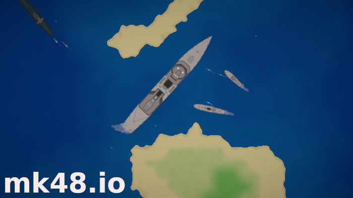

# Mk48.io Game

[](https://github.com/SoftbearStudios/mk48/actions/workflows/build.yml)
<a href='https://discord.gg/YMheuFQWTX'>
  
</a>



[Mk48.io](https://mk48.io) is an online multiplayer naval combat game, in which you take command of a ship and sail your way to victory. Watch out for torpedoes!

- [Ship Suggestions](https://github.com/SoftbearStudios/mk48/discussions/132)


[简体中文](./cn_README.md)

## Building

### Tools

The project is pinned to `nightly-2022-08-14`, and the CI build uses Trunk `0.15.0`. Use these versions to match the verified build environment. The local build was also checked with Rust `1.65.0-nightly` and Trunk `0.16.0`; pinning Trunk avoids accidentally installing an incompatible newer release.

On Ubuntu/Debian, install the native build tools and Rust toolchain:

```sh
sudo apt-get update
sudo apt-get install -y build-essential
rustup toolchain install nightly-2022-08-14
rustup target add wasm32-unknown-unknown --toolchain nightly-2022-08-14
cargo install --locked trunk --version 0.15.0
```

Install `rustup` first if it is not already available ([instructions](https://rustup.rs/)). On other operating systems, install the equivalent C/C++ build tools and `make`. The repository's `rust-toolchain.toml` selects the pinned Rust nightly when you build from the repository.

Trunk handles the WebAssembly binding and optimization tools during the build; do not install separate `wasm-bindgen` or `wasm-opt` binaries.

### Client

From the repository root, run `make -C client` (equivalent to `cd client && trunk build --release`). This creates the optimized client in `client/dist`.

### Server

The server embeds the client files from `client/dist`, so build the client first. From the repository root:

```sh
make -C client
make -C server
```

The server starts with the repository's development settings (read-only database, debug core, HTTP port `8081`). Open `http://localhost:8081` (or the forwarded port in your development environment). Press `Ctrl+C` in the server terminal to stop it.

If you change client code, rebuild it with `make -C client` before rebuilding/restarting the server so the new files are embedded.

## Developing

If you follow the *Building* steps, you have a fully functioning game (could be used to host a private server). If your goal
is to modify the game, you may want to read more :)

### Entity data

Entities (ships, weapons, aircraft, collectibles, obstacles, decoys, etc.) are defined at the bottom of
`common/src/entity/_type.rs`.

### Entity textures

Each entity type must be accompanied by a texture of the same name in the spritesheet, which comes with the
repository. If entity textures need to be changed, see instructions in the `sprite_sheet_packer` directory.

### Engine

Both client and server rely on our custom game engine (which is present in the `engine` directory).

#### Admin interface (optional)
One notable feature of the engine is an (optional) admin interface. To build it:

0. Install NodeJS 14 or higher ([here](https://nodejs.org/en/download/))
1. Enter `/engine/js`
2. `make`
3. Deploy the server to host the admin interface
4. Go to `localhost:8081/admin/`
5. Paste the contents of `engine/game_server/src/auth.txt`, generated randomly by a build script, into the alert dialog

### Macros

Many macros are utilized by the codebase. Mk48-specific macros can be found in the `macros` directory,
and game engine macros can be found in the `engine/engine_macros` directory. A few notable macros are:
- Mk48 entity loader (generates `EntityData` for all entity types, used by both client and server)
- Game engine audio loader (generates `Audio` enum for client, with a variant per sound)
- Game engine settings (generates Javascript bindings for settings structs)
- Game engine renderer layer (for composable rendering layers)

## Contributing
See [Contributing](https://github.com/SoftbearStudios/mk48/wiki/Contributing) Wiki page.

## Trademark

Mk48.io is a trademark of Softbear, Inc.
