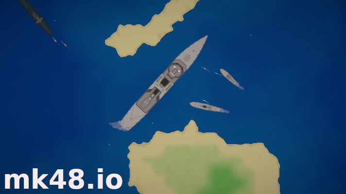

# Mk48.io 游戏

[](https://github.com/SoftbearStudios/mk48/actions/workflows/build.yml)
<a href='https://discord.gg/YMheuFQWTX'>
  
</a>



[Mk48.io](https://mk48.io) 是一款在线多人海战游戏。玩家将指挥舰船，在海上奋战并争取胜利。小心鱼雷！

- [舰船建议](https://github.com/SoftbearStudios/mk48/discussions/132)

## 构建

### 所需工具

本项目固定使用 `nightly-2022-08-14`，CI 构建使用 Trunk `0.15.0`。请使用这两个版本，以匹配已验证的构建环境。本机也已使用 Rust `1.65.0-nightly` 和 Trunk `0.16.0` 成功构建；固定 Trunk 版本可以避免误装不兼容的新版本。

在 Ubuntu/Debian 上，安装本地构建工具和 Rust 工具链：

```sh
sudo apt-get update
sudo apt-get install -y build-essential
rustup toolchain install nightly-2022-08-14
rustup target add wasm32-unknown-unknown --toolchain nightly-2022-08-14
cargo install --locked trunk --version 0.15.0
```

如果尚未安装 `rustup`，请先按[安装说明](https://rustup.rs/)安装。其他操作系统请安装对应的 C/C++ 构建工具和 `make`。在仓库中构建时，`rust-toolchain.toml` 会自动选择指定的 Rust nightly 版本。

Trunk 会在构建过程中处理 WebAssembly 绑定和优化工具；无需单独安装 `wasm-bindgen` 或 `wasm-opt`。

### 客户端

在仓库根目录运行 `make -C client`（等价于 `cd client && trunk build --release`），将优化后的客户端生成到 `client/dist`。

### 服务器

服务器会将 `client/dist` 中的客户端文件嵌入自身，因此请先构建客户端。在仓库根目录依次运行：

```sh
make -C client
make -C server
```

服务器会使用仓库提供的开发配置启动（只读数据库、debug core，HTTP 端口为 `8081`）。打开 `http://localhost:8081`；如果使用开发容器，请访问转发出来的端口。按服务器终端中的 `Ctrl+C` 可停止服务器。

修改客户端代码后，请先重新运行 `make -C client`，再重新编译并启动服务器，这样新客户端文件才会被嵌入。

## 开发

按照“构建”部分的步骤操作后，即可运行游戏，也可以用来搭建私人服务器。如果希望修改游戏，可以参考以下说明。

### 实体数据

实体（舰船、武器、飞机、可收集物、障碍物、诱饵等）定义在 `common/src/entity/_type.rs` 文件末尾附近。

### 实体纹理

每种实体都需要在仓库自带的精灵图中拥有一个同名纹理。修改实体纹理时，请参考 `sprite_sheet_packer` 目录中的说明。

### 引擎

客户端和服务器都依赖仓库 `engine` 目录中的自定义游戏引擎。

#### 管理员界面（可选）

引擎提供了一个可选的管理员界面。构建步骤如下：

0. 安装 Node.js 14 或更高版本（[下载页面](https://nodejs.org/en/download/)）。
1. 进入 `engine/js` 目录。
2. 运行 `make`。
3. 部署服务器以提供管理员界面。
4. 打开 `http://localhost:8081/admin/`。
5. 将构建脚本生成的 `engine/game_server/src/auth.txt` 文件内容粘贴到弹出的提示框中。

### 宏

项目使用了许多宏。Mk48 专用宏位于 `macros` 目录，游戏引擎宏位于 `engine/engine_macros` 目录。主要包括：

- Mk48 实体加载器：为所有实体类型生成 `EntityData`，供客户端和服务器使用。
- 游戏引擎音频加载器：为每种声音生成客户端 `Audio` 枚举成员。
- 游戏引擎设置：为设置结构体生成 JavaScript 绑定。
- 游戏引擎渲染层：用于组合渲染层。

## 贡献

请参阅 [贡献指南](https://github.com/SoftbearStudios/mk48/wiki/Contributing)。

## 商标

Mk48.io 是 Softbear, Inc. 的商标。

## 该版本新增了账户功能

当有账户注册，服务器会在account目录下建立以那个账户名为名的txt文件，其内容大致如下:

player_该账户唯一id{
power:player;
}

id为自动生成的字母+数字组合
power表示该账户权限，共有:player , admin , superadmin 三个选项
player为普通账户，admin为管理员账户，superadmin为超级管理员账户，你可更改对应的字段来实现账户权限的更改。(管理员可禁言普通玩家，超级管理员可禁言管理员或普通玩家)**保管好你的账户密码！**
账户密码加密保存在account/password 目录下，以账户唯一id为文件名。某个账户所有者如果忘记密码，你可删除其账户所对应的密码文件来让那个账户的密码重置为默认密码123456 ,**然后通知那个人以此密码登陆账户，并更改密码！**